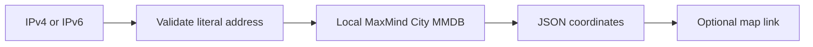

# Spring Boot IP Geolocation API with MaxMind GeoLite2

[](https://github.com/dibyapp/location-from-ip-address-service/actions/workflows/api-check.yml)
[](LICENSE)

A small **Java / Spring Boot IP geolocation service** that returns approximate latitude and longitude
from a local **MaxMind GeoLite2 City or GeoIP2 City MMDB database**. It includes a JSON endpoint and a
browser lookup page. Learn how to turn an IPv4 or IPv6 address into coordinates without sending every
lookup to a third-party geolocation API.

**This is a learning demo on Spring Boot 2.7.3, not a hardened public service.** IP geolocation is
approximate: it does not locate a person, phone, or street address. Database freshness, network routing,
VPNs, and mobile networks affect results. See [MaxMind's accuracy guidance](https://support.maxmind.com/knowledge-base/articles/maxmind-geolocation-accuracy).

## What you get

- `GET /loc?ip=...`: JSON latitude/longitude from the local City database.
- `GET /getPages`: mobile-friendly lookup form with an optional OpenStreetMap link.
- Literal IPv4/IPv6 validation; hostname lookup is rejected without DNS resolution.
- Configurable database path through `GEOIP_DATABASE_PATH`.
- Reused database reader, closed at shutdown; actionable 400/404/503 responses.
- Maven wrapper, tests without a real database, and CI on Linux, Windows, and macOS.

[Quick start](#quick-start) · [API](#api-reference) · [Troubleshooting](#troubleshooting) ·
[Validation](docs/VALIDATION.md) · [Contributing](CONTRIBUTING.md)



## Quick start

### 1. Get the source and Java

Use **JDK 17** for the documented and CI setup. The POM targets Java 8 bytecode; older JDKs are not
part of this CI matrix. Maven 3.9.16 is downloaded by the checked-in wrapper on first use.

```bash
git clone https://github.com/dibyapp/location-from-ip-address-service.git
cd location-from-ip-address-service
java -version
```

### 2. Obtain a City database

Get your own **GeoLite2 City `.mmdb`** file through a [MaxMind account](https://dev.maxmind.com/geoip/geolite2-free-geolocation-data/),
or use a licensed GeoIP2 City file. Extract the archive and place the file at `data/GeoLite2-City.mmdb`.
The `data/` directory and `.mmdb` files are ignored by Git. This repository does not include or
automatically download database data, account details, or license keys.

MaxMind download/update credentials belong in your private download tooling, not this app. Maintain
the database and follow the provider's current terms, including any requirements for your use or redistribution.
MIT covers the source code, **not the database**. Country and ASN databases cannot supply City coordinates.

### 3. Test and run

Linux / Ubuntu / macOS:

```bash
chmod +x mvnw
./mvnw test
export GEOIP_DATABASE_PATH="$PWD/data/GeoLite2-City.mmdb"
./mvnw spring-boot:run
```

Windows PowerShell:

```powershell
.\mvnw.cmd test
$env:GEOIP_DATABASE_PATH = Join-Path (Get-Location) 'data/GeoLite2-City.mmdb'
.\mvnw.cmd spring-boot:run
```

Open **http://localhost:8080/getPages**. The app binds to loopback by default. Stop your own instance
with Ctrl+C. If port 8080 is already used, set `PORT` to a free port before starting.

Tests and application startup do not require a database. A valid lookup returns **503** until a readable
City database is configured. The first lookup opens the database, and later lookups reuse it.

To create a runnable JAR, run `./mvnw package` (Windows: `.\mvnw.cmd package`), then:

```bash
java -jar target/location-service-1-0.0.1-SNAPSHOT.jar
```

## API reference

| Request | Behavior |
| --- | --- |
| `GET /loc?ip=<literal-address>` | Approximate latitude and longitude as JSON strings |
| `GET /getPages` | HTML lookup form |
| Missing or malformed `ip`, hostname, unsupported zone identifier | HTTP 400 |
| Address absent from the database, or no coordinates | HTTP 404 |
| Unconfigured, unreadable, invalid, or incompatible database | HTTP 503 |

For a public address of your choice:

```bash
curl --get --data-urlencode "ip=YOUR_PUBLIC_IP" http://localhost:8080/loc
```

In PowerShell use `curl.exe` for the curl command, or `Invoke-RestMethod` with an encoded query value.
The following shape is **illustrative**, not a lookup of your IP:

```json
{"latitude":"12.5","longitude":"-34.5"}
```

Documentation addresses such as `192.0.2.1` and `2001:db8::1` are useful for tests but normally have
no geographic record. Loopback and private network addresses usually do not map to meaningful City records.

## Configuration

| Environment variable | Default | Purpose |
| --- | --- | --- |
| `GEOIP_DATABASE_PATH` | empty | Filesystem path to a City MMDB file |
| `PORT` | `8080` | HTTP listen port |
| `SERVER_ADDRESS` | `127.0.0.1` | Listen address; keep loopback for local use |

Restart the application after changing its configuration or replacing the database. Depending on the OS,
the database reader's memory mapping may prevent replacement while the JVM is running.

## Privacy and production boundaries

Lookups use the local database. The HTML page has no third-party scripts or embedded map requests.
Opening its OpenStreetMap link sends the displayed coordinates to that service; no API key is required
for the link. Entered addresses travel in the URL query, so browsers, proxies, or server access logs can
record them. Avoid logging or posting personal IPs unnecessarily.

There is no authentication, rate limiting, TLS setup, or deployment configuration here. Before exposing
a service publicly, upgrade and review the legacy dependencies, add operational protections, decide
what data/logs you retain, and check the database's licensing terms. Binding beyond loopback is an
explicit configuration change. This project does not automatically publish or deploy anything.

## Troubleshooting

**503 / database unavailable:** set `GEOIP_DATABASE_PATH`, confirm the file is readable by the Java process,
and use a City `.mmdb` rather than an archive, CSV, Country, or ASN file. Restart after configuration changes.

**404 for a valid IP:** the selected database has no record or coordinates. Try a known public address you
are authorized to test and keep your database current. A syntactically valid IP is not guaranteed to have a location.

**400 for a hostname:** the API accepts literal IP addresses only. Resolve names separately if you need that behavior.

**No precise location / VPN mismatch:** coordinates describe approximate network location, not a device's GPS position.
Do not infer an individual's identity or home address from these coordinates.

**Wrapper cannot download Maven:** first use requires network access. Confirm `JAVA_HOME`/`java -version`,
proxy configuration, and access to Maven Central. Alternatively, use an installed Maven 3.9.x with `mvn test`.

## Development and license

See [validation](docs/VALIDATION.md) for what the tests cover. Useful contributions include dependency
modernization, licensed test fixtures, accuracy-radius output, and privacy-conscious operational guidance.
Open an issue with a reproducible example; sanitize IPs, paths, credentials, and logs first.

Created by [dibyapp](https://github.com/dibyapp). Original source is [MIT licensed](LICENSE).
[Third-party terms](THIRD_PARTY_NOTICES.md) continue to apply. If this example helps you learn Spring Boot
or GeoLite2, a useful issue, improvement, or star helps other developers find it.
